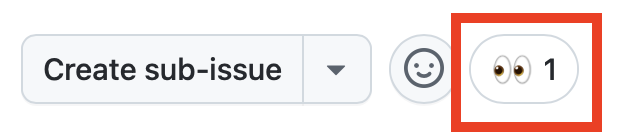

| [← Lección anterior: Instrucciones personalizadas][previous-lesson] |
|:--|

Es probable que haya muy pocas organizaciones que no tengan problemas con la deuda técnica. Puede tratarse de problemas de seguridad sin resolver, código heredado que necesita actualizarse o solicitudes de funcionalidades que llevan tiempo en la lista de tareas pendientes por falta de tiempo para implementarlas. El agente de GitHub Copilot en la nube está diseñado para realizar tareas como actualizar código y añadir funcionalidades de forma autónoma. Cuando termina, genera una solicitud de incorporación de cambios (PR) en borrador para que la revise un desarrollador. Así puedes delegar tareas tediosas, acelerar el desarrollo y centrarte en cuestiones de mayor alcance.

Con el agente de Copilot en la nube, explorarás lo siguiente:

- personalizar el entorno para generar código;
- asegurarte de que las operaciones se realizan de forma segura;
- comprender la importancia de delimitar claramente las incidencias;
- asignar incidencias a Copilot.

## Escenarios

Tailspin Toys tiene deuda técnica que quiere resolver. Los contratistas que crearon la primera versión del sitio dejaron la documentación en un estado poco adecuado: comprobarás que no hay ninguna. Como primer paso, el equipo quiere añadir comentarios de documentación de TypeScript (TSDoc) a todas las funciones exportadas de la aplicación.

Además, el equipo de diseño quiere mejorar la forma de descubrir juegos. Quiere que la página de detalles de cada juego muestre juegos relacionados —otros títulos de la misma categoría— para que las personas puedan seguir explorando. Todavía no necesita una implementación pulida; solo algo que pueda usar para las pruebas de aceptación de la experiencia de usuario. Aunque esta tarea bloquea el trabajo, ahora mismo hay otras incidencias de mayor prioridad.

Son tareas que pueden quedar relegadas con facilidad y que conviene asignar al agente de Copilot en la nube. Este puede trabajar en ellas de forma asíncrona mientras sigues con otras tareas y, cuando termine, puedes revisar su trabajo y comprobar que todo esté como esperabas.

## Presentación del agente de GitHub Copilot en la nube

[El agente de GitHub Copilot en la nube](https://docs.github.com/copilot/concepts/agents/cloud-agent/about-cloud-agent#overview-of-copilot-cloud-agent-formerly-copilot-coding-agent) puede realizar tareas en segundo plano de forma similar a un desarrollador. Igual que con un desarrollador, puedes asignarle trabajo de varias maneras, por ejemplo, [asignándole una incidencia de GitHub a Copilot](https://docs.github.com/copilot/how-tos/use-copilot-agents/cloud-agent/start-copilot-sessions). Una vez asignada, Copilot crea una PR en borrador para realizar el seguimiento del trabajo, prepara un entorno y empieza a trabajar en la tarea. Puedes consultar la sesión de Copilot mientras sigue en curso o después de que termine. Cuando la solución propuesta esté lista para que la revises, te mencionará en la PR.

## La importancia de delimitar bien las instrucciones

GitHub Copilot no hace magia: no puedes saltarte el trabajo de pensar. Incluso las tareas que parecen sencillas pueden ser complejas cuando las analizas a fondo, así que [delimita con cuidado las tareas para el agente de Copilot en la nube][cloud-agent-best-practices]. Trátalo como a un compañero de programación basado en inteligencia artificial (IA): trabaja por etapas, aprende, experimenta y adapta el enfoque sobre la marcha. La incorporación de IA generativa no cambia los fundamentos del desarrollo de software.

## Instrucciones personalizadas de este repositorio

En ejercicios anteriores has conocido las instrucciones personalizadas y cómo guían a Copilot. Si ya has completado un ejercicio práctico sobre instrucciones personalizadas, habrás visto `.github/copilot-instructions.md` en acción; si no, este es un buen momento para echarle un vistazo. Antes de asignar trabajo al agente de Copilot en la nube, revisa en modo de solo lectura los archivos de instrucciones que ya incluye este repositorio para que después puedas reconocer su efecto.

Abre los siguientes archivos en la interfaz web de GitHub para tu repositorio o en un Codespace que ya tengas en ejecución:

- `.github/copilot-instructions.md`: revisa la sección **Code standards**, en especial las expectativas sobre las convenciones de TypeScript y los comentarios de documentación TSDoc.
- `.github/instructions/unit-tests.instructions.md`: fíjate en el frontmatter `applyTo`, que limita estas instrucciones a los archivos `**/*.test.ts`.

Cuando asignes la incidencia `Code lacks documentation` al agente de Copilot en la nube en la siguiente sección, observa si la PR resultante incluye comentarios TSDoc, convenciones de TypeScript y encabezados de comentarios. Estas indicaciones proceden de los archivos de instrucciones y volverás a tenerlas en cuenta al revisar las PR en un ejercicio posterior.

## Configura el entorno de desarrollo del agente de Copilot en la nube

Para crear código, normalmente se necesita un entorno concreto y ejecutar algunos scripts de configuración para que todo esté listo. Lo mismo ocurre al asignar tareas a Copilot, que trabaja de forma parecida a un ingeniero de software.

El agente en la nube usa [GitHub Actions][github-actions] como entorno de trabajo. Puedes personalizarlo con un [flujo de trabajo de configuración especial][setup-workflow], definido en `.github/workflows/copilot-setup-steps.yml`, que se ejecuta antes de que empiece a trabajar. Así puede acceder a las herramientas y dependencias necesarias para el desarrollo. El flujo ya está configurado para este taller. Asegura que Copilot tenga acceso a Node.js, las dependencias del proyecto, los navegadores para las pruebas de extremo a extremo y la base de datos SQLite migrada y con datos iniciales para la única aplicación Astro:

```yaml
name: "Copilot Setup Steps"

# Permite probar los pasos de configuración desde la pestaña "Actions" del repositorio
on: workflow_dispatch

env:
  ASTRO_TELEMETRY_DISABLED: "1"

jobs:
  copilot-setup-steps:
    runs-on: ubuntu-latest
    # Establece los permisos mínimos necesarios para *tus pasos*. Copilot tendrá su propio token para las operaciones que realice.
    permissions:
      # Para clonar el repositorio como parte de los pasos de configuración, por ejemplo, para instalar dependencias, necesitas el permiso `contents: read`. Si no lo clonas en estos pasos, Copilot lo hará automáticamente cuando terminen.
      contents: read
    steps:
      - name: Checkout code
        uses: actions/checkout@v5

      # Configuración del frontend y de la aplicación: Node.js (ahora toda la aplicación usa Astro y Drizzle/libSQL)
      - name: Set up Node.js
        uses: actions/setup-node@v6
        with:
          node-version: "lts/*"
          cache: "npm"
          cache-dependency-path: "./package-lock.json"

      - name: Install JavaScript dependencies
        run: npm ci

      - name: Install Playwright browsers
        run: npx playwright install --with-deps chromium

      # Migra y carga los datos iniciales en SQLite local para que las compilaciones y las pruebas tengan datos.
      - name: Set up the database
        run: npm run db:setup
```

El archivo se parece a cualquier otro flujo de trabajo de GitHub, pero tiene algunos aspectos importantes:

- Contiene un único trabajo llamado `copilot-setup-steps`. GitHub Actions lo ejecuta antes de que Copilot empiece a trabajar en la PR.
- El desencadenador `workflow_dispatch` permite ejecutar el flujo de trabajo manualmente desde la pestaña **Actions** del repositorio. Esto resulta útil para comprobar que funciona correctamente sin tener que esperar a que Copilot lo ejecute.

## Añade documentación

Aunque todo el mundo reconoce la importancia de la documentación, muchos proyectos tienen información desactualizada o carecen de ella. Esta deuda técnica suele quedar desatendida, lo que reduce la productividad y dificulta mantener el código o incorporar a nuevos desarrolladores. Copilot destaca en la creación de documentación, así que esta es una incidencia ideal para asignarle. Trabajará en segundo plano para generar la documentación necesaria. En un ejercicio futuro volverás para revisar el resultado.

1. Abre una pestaña nueva del navegador y ve a tu repositorio en github.com.
2. Selecciona la pestaña **Issues**.
3. Selecciona **New issue** para abrir el cuadro de diálogo de una incidencia nueva.
4. Selecciona **Blank issue** para crearla.
5. Escribe `Code lacks documentation` en el campo **Title**.
6. Escribe lo siguiente en **Description**:

   ```plaintext
   Nuestra organización requiere que las funciones y los métodos incluyan comentarios de documentación TSDoc cuando sean útiles. Por desgracia, las actualizaciones recientes no han seguido este estándar. Tenemos que actualizar el código existente para incluir comentarios de documentación donde aclaren el comportamiento.
   ```

7. Selecciona **Create** para crear la incidencia.
8. En el lado derecho, selecciona **Assign to Copilot** para abrir el cuadro de diálogo de asignación.

   

9. Selecciona **Assign**.

   

10. Selecciona la pestaña **Pull Requests**.
11. Abre la PR que se acaba de generar. Su título será parecido a `[WIP]: Code lacks documentation`. Si todavía no aparece ninguna PR nueva, espera un momento y actualiza la ventana del navegador.
12. Al cabo de unos minutos, Copilot debería haber creado una lista de tareas.

> [!NOTE]
> La lista de tareas de Copilot puede tardar varios minutos en aparecer en la PR. Copilot está preparando su entorno (ejecutando el flujo de trabajo que acabas de revisar), analizando el proyecto y determinando cómo abordar la tarea.

13. Revisa la lista y las tareas que va a completar.
14. Desplázate por la cronología de la PR. Deberías ver una actualización que indica que Copilot ha empezado a trabajar en la incidencia.
15. Selecciona el botón **View session**.

   

> [!CAUTION]
> Puede que tengas que actualizar la ventana para ver el indicador actualizado.

16. Observa que puedes desplazarte por la sesión en directo y ver cómo Copilot resuelve el problema: explora el código y comprende su estado, se detiene a pensar y decidir el plan adecuado y crea código.

Es probable que esto tarde varios minutos. Una de las principales ventajas del agente de Copilot en la nube es que puede trabajar de forma asíncrona y dejarte tiempo para otras tareas. Aprovecharemos esa característica asignándole otra tarea y, mientras tanto, nos centraremos en escribir código para añadir funcionalidades a la aplicación.

## Añade una sección de juegos relacionados a la página de detalles

Como ya se ha indicado, una gran ventaja del agente de GitHub Copilot en la nube es que permite dividir el trabajo: puedes centrarte en unas tareas mientras el agente se ocupa de otras. Aunque añadir una sección de juegos relacionados para el equipo de diseño no debería llevar mucho tiempo, puedes aprovechar ese tiempo para otras tareas. ¡Vamos a asignársela al agente de Copilot en la nube!

1. Vuelve a tu repositorio en github.com.
2. Selecciona la pestaña **Issues**.
3. Selecciona **New issue** para abrir el cuadro de diálogo de una incidencia nueva.
4. Selecciona **Blank issue** para usar la plantilla en blanco.
5. Escribe `Show related games on the game details page` en el campo **Title**.
6. Escribe lo siguiente en **Description**:

   ```markdown
   Queremos ayudar a descubrir más juegos mostrando juegos relacionados en la página de detalles de cada juego. El equipo de diseño quiere explorar la experiencia de usuario y realizar pruebas de aceptación. Estos son los requisitos:

   - Añadir un helper de acceso a datos en `src/lib/` que devuelva otros juegos de la misma categoría que uno determinado, sin incluir ese juego
   - Mostrar una sección "Related games" en la página de detalles que use el helper
   - Gestionar el caso en que un juego no tenga juegos relacionados
   - Crear pruebas unitarias para el nuevo helper
   - Confirmar que todas las pruebas pasan antes de crear la PR
   ```

7. Selecciona **Create** para crear la incidencia.
8. En el lado derecho, selecciona **Assign to Copilot** para abrir el cuadro de diálogo de asignación.

   

9. Selecciona **Assign**.

Poco después, verás varios 👀 en el primer comentario de la incidencia. Esto indica que Copilot ya está trabajando en ella.



Copilot ya está trabajando en tu segunda solicitud. El agente de Copilot en la nube funciona de forma parecida a un ingeniero de software, así que no hace falta que lo supervises continuamente: puedes revisar su trabajo cuando termine. Ahora vamos a centrarnos en crear y utilizar agentes personalizados.

## Resumen y próximos pasos

En este ejercicio has explorado [el agente de GitHub Copilot en la nube][copilot-agents]. Puedes asignarle incidencias para que trabaje de forma asíncrona. Copilot puede ayudarte a resolver deuda técnica, crear funcionalidades o migrar código de un framework a otro.

Has explorado estos conceptos:

- personalizar el entorno para generar código;
- asegurarte de que las operaciones se realizan de forma segura;
- comprender la importancia de delimitar claramente las incidencias;
- asignar incidencias a Copilot.

Mientras el agente de Copilot en la nube trabaja en segundo plano, puedes centrarte en crear y utilizar agentes personalizados. [El agente de Copilot en la nube también puede usar servidores de Model Context Protocol (MCP)][cloud-agent-mcp] y puede acceder a instrucciones personalizadas, que ya exploraste en módulos anteriores.

## Recursos

- [Acerca del agente de Copilot][copilot-agents]
- [Asignar incidencias de GitHub a Copilot][assign-issue]
- [Prácticas recomendadas para el flujo de trabajo de configuración del agente de Copilot en la nube][cloud-agent-best-practices]

| [Siguiente lección: Agentes personalizados →][next-lesson] |
|--:|

[previous-lesson]: ../1-custom-instructions/
[next-lesson]: ../3-custom-agents/
[cloud-agent-mcp]: https://docs.github.com/copilot/how-tos/copilot-on-github/customize-copilot/customize-cloud-agent/extend-cloud-agent-with-mcp
[assign-issue]: https://docs.github.com/copilot/how-tos/use-copilot-agents/cloud-agent/start-copilot-sessions
[setup-workflow]: https://docs.github.com/copilot/how-tos/copilot-on-github/customize-copilot/customize-cloud-agent/customize-the-agent-environment
[copilot-agents]: https://docs.github.com/copilot/concepts/agents/cloud-agent/about-cloud-agent
[cloud-agent-best-practices]: https://docs.github.com/copilot/how-tos/copilot-on-github/customize-copilot/customize-cloud-agent/customize-the-agent-environment
[github-actions]: https://docs.github.com/actions
